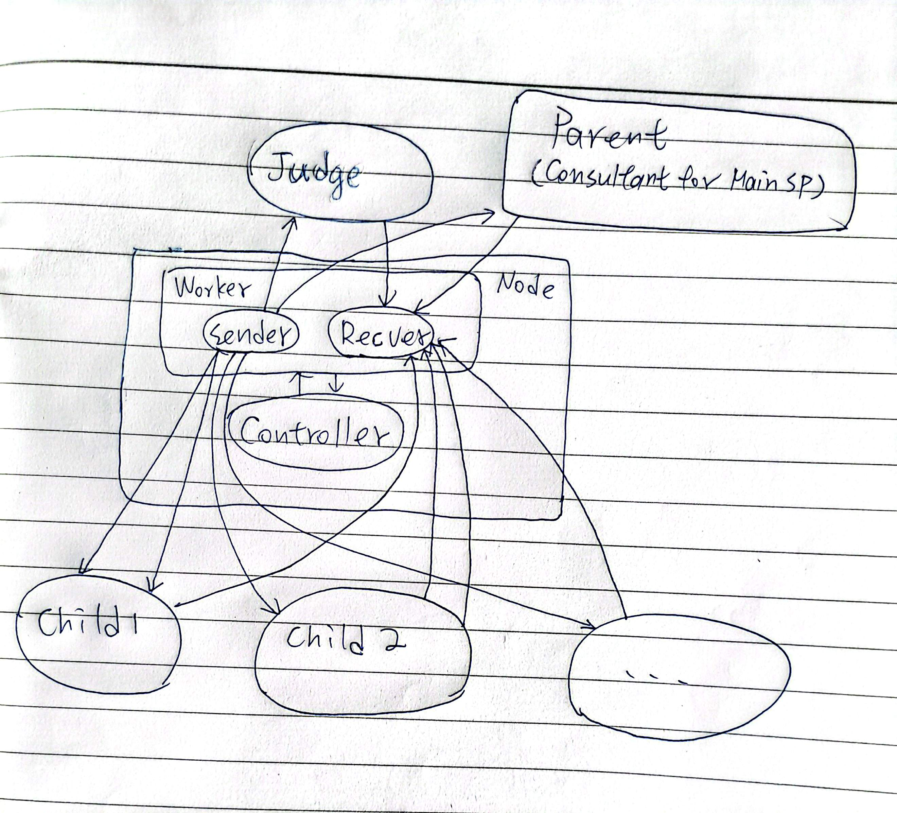

# sp-hw2-student-template

這是一些我自己實作的筆記。

## main SP 與 child 區分

- main SP: 執行 `./sp`
- child: 執行 `./sp <cmd-fifo> <reply-fifo> <parent-in-fd> <parent-out-fd> <judge-pid>`

## 架構圖

## 自訂協議

- fetch: 使用與作業相同的協議。用路由表的方式記錄 hash & child pid 的對應。
- kill: 直接關閉傳送端的 pipe，child 收到 EOF 後啟動自殺流程。清理完畢後，關閉對 parent 的 write pipe。Parent 收到 EOF 後，呼叫 waitpid to reap。
- consult: Consultant 本質上我當他是跑在 Main SP 上的一個服務。他的結構跟普通的 Node 雷同，只是他持有的 PID 是 FAKE_PID，並且身上的 in_fd, out_fd 與 Main SP 的 search 的 in, out 是成對的 pipe (即在 main SP 中就是自己傳給自己的 pipe)。當 Consultant 收到完整的一段指令後，才會 fork + exec 真正的 consultant program 來取得結果。
*雖然架構圖上畫 (Consultant) 在 Parent 那格，但實際上是運行在 Worker 內，只是我們在與其溝通時是視同 Search Parent 的方式在溝通。*

## 幾個原則

- 有搭配 free 方法的物件型態，其 create 函式回傳值為物件指標，否則回傳完整物件。
- 自訂的動態 buffer 名稱是 buff，char array (char *) buffer 則是 buf。
